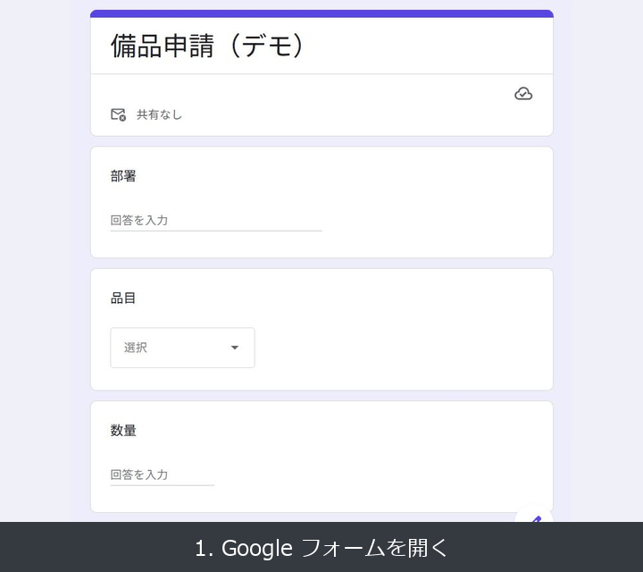

# gas-form-demo

Google フォームに回答が届くたびに、スプレッドシートで集計を作り直し、担当者にメールで知らせます。そのための Google Apps Script（GAS：Google のサービスを自動で動かす仕組み）のデモです。

題材は「社内の備品申請」です。フォームで「部署・品目・数量」を受け付け、品目ごとの件数と数量の合計を「集計」シートにまとめます。

> **確認の状況（2026-11-16）**
> - 集計の計算と処理の流れは、Node.js v24 上のテスト6件で確認しました（Google のサービスは、テスト用の代わりの部品に置き換えています）。
> - Google 上では、作者のアカウントで次の3点を確認しました（2026-11-16）。
>   - フォームを送信すると、スクリプトが動いて「集計」シートが更新されること（エラー0件）
>   - 通知メールが届き、本文に「部署」の値が入っていないこと
>   - プロジェクトが求める権限が2つだけであること

## 動く様子

<!-- GIF を撮影したら、下の行の先頭と末尾のコメント記号を外して表示する -->
<!--  -->

GIF の置き場所は `docs/demo.gif` です（まだ撮影していません）。撮る予定の流れは次のとおりです。

1. Google フォームで「品目：ボールペン、数量：10」を送信する。
2. スプレッドシートの「フォームの回答 1」シートに行が増える。
3. 少しあとに「集計」シートが作り直され、ボールペンの件数と数量の合計が増える。
4. 通知先のメールに「[備品申請] ボールペン ×10（累計◯件）」という件名のメールが届く。

Node.js 上で `sample/responses.csv` の5件を集計すると、次の表になります（Google のシート上ではまだ確かめていません。「最終更新」には、集計した日時が入ります）。

| 品目 | 件数 | 数量の合計 |
|---|---|---|
| ボールペン | 2 | 14 |
| コピー用紙 | 2 | 3 |
| 付箋 | 1 | 5 |
| 合計 | 5 | 22 |
| 数量が読めなかった件数 | 0 | |
| 最終更新 | 2026-11-16 13:27 | |

## スクリプトが求める権限は2つだけ

`src/appsscript.json`（マニフェスト：スクリプト全体の設定ファイル）の oauthScopes（スクリプトが求める権限の一覧）で、権限を2つに絞っています。

| 権限 | 使う理由 |
|---|---|
| `https://www.googleapis.com/auth/spreadsheets.currentonly` | このスクリプトが紐づいているスプレッドシート1つだけを読み書きする。ほかのスプレッドシートには触れない |
| `https://www.googleapis.com/auth/script.send_mail` | 自分のアカウントからメールを送るだけ。受信トレイを読む権限（Gmail の権限）は求めない |

どちらも、使っている命令（メソッド）に必要な権限として、公式リファレンスに書かれているものです（2026-11-16 確認）。

- `SpreadsheetApp.getActiveSpreadsheet()`：https://developers.google.com/apps-script/reference/spreadsheet/spreadsheet-app
- `MailApp.sendEmail()`：https://developers.google.com/apps-script/reference/mail/mail-app

通知先のメールアドレスはコードに書かず、スクリプト プロパティ（スクリプトごとに値を保存できる場所）に入れます。リポジトリにメールアドレスが残らないようにするためです。メール本文には、品目・数量・集計だけを入れ、「部署」の値は入れません。

## ファイル構成

```
gas-form-demo/
├─ src/
│  ├─ Code.gs            入口（フォーム送信時に呼ばれる）、集計シートへの書き出し、メール送信
│  ├─ Aggregate.gs       集計の計算だけ（Google のサービスに触らない）
│  └─ appsscript.json    マニフェスト（スクリプト全体の設定。権限を2つに絞る）
├─ sample/
│  └─ responses.csv      試し用の回答5件（架空のデータ）
├─ tests/
│  └─ gas.test.mjs       Node.js で動かすテスト（6件）
├─ docs/                 GIF の置き場所（docs/demo.gif）
├─ package.json          npm test でテストを実行するための設定
└─ LICENSE               MIT ライセンス
```

## 動かし方

所要時間は15分ほどの見込みです。権限の承認は、使う人が自分の Google アカウントで行います。作者がパスワードを預かることはありません。

> この章の手順は、作者のアカウントで通知メールが届くまで確かめました。画面の文言は、Google の画面の変更で変わることがあります。

### 1. フォームを作る

1. Google フォームを新しく作ります。
2. 下の表の3つの質問を、表と同じ質問名で追加します。

   | 質問名 | 種類 |
   |---|---|
   | 部署 | 記述式 |
   | 品目 | プルダウン（例：ボールペン、コピー用紙、付箋） |
   | 数量 | 記述式（回答の検証で「数値」「整数」を選ぶ） |

   質問名を変える場合は、`Code.gs` の `CONFIG` も同じ名前に直します。

3. フォームの「回答」タブで「スプレッドシートにリンク」を押し、新しいスプレッドシートを作ります。

### 2. スクリプトを貼る

1. できたスプレッドシートを開き、メニューの「拡張機能」→「Apps Script」を選びます。
2. 最初からある `コード.gs` の中身を消して、`src/Code.gs` の中身を貼ります。
3. 左の「ファイル」の「＋」→「スクリプト」で `Aggregate` を作り、`src/Aggregate.gs` の中身を貼ります。
4. 左の歯車（プロジェクトの設定）を開き、「『appsscript.json』マニフェスト ファイルをエディタで表示する」にチェックを入れます。
5. エディタに出てきた `appsscript.json` の中身を、`src/appsscript.json` の中身に置き換えます。
6. 保存します（Ctrl + S）。

### 3. 通知先を設定する

1. 歯車（プロジェクトの設定）の下のほうにある「スクリプト プロパティ」で「スクリプト プロパティを追加」を押します。
2. プロパティに `NOTIFY_TO`、値に通知を受け取るメールアドレスを入れて保存します。

設定しない場合は、集計だけ行い、メールは送りません。

### 4. トリガーを登録し、権限を承認する

トリガーは、決まったきっかけで関数を自動で動かす設定です。ここでは「フォームが送信されたとき」をきっかけにします。

1. 左の時計のアイコン（トリガー）を開き、「トリガーを追加」を押します。
2. 次の表のとおりに3つの項目を選び、「保存」を押します。

   | 項目 | 選ぶもの |
   |---|---|
   | 実行する関数 | `onFormSubmit` |
   | イベントのソース | スプレッドシートから |
   | イベントの種類 | フォーム送信時 |

3. 保存すると、Google アカウントの選択と権限の確認の画面が出ます。自分のアカウントを選びます。
4. 「このアプリは Google で確認されていません」と出た場合は、自分で作ったスクリプトなので、左下の「詳細」→「（プロジェクト名）（安全ではないページ）に移動」と進みます。
5. 権限の一覧が、スプレッドシートに関するものとメール送信に関するものの2つだけかを確かめます（作者の環境では、Apps Script の「概要」画面に「View and manage spreadsheets that this application has been installed in」と「Send email as you」の2つが表示されました。承認画面の文言は、表示言語によって変わります）。
6. 2つだけなら「許可」を押します。

画面の文言は、Google の画面の変更で違うことがあります。権限の一覧に、上の2つ以外（Google ドライブ全体、Gmail の読み取りなど）が出た場合は、許可せずに `appsscript.json` を貼り忘れていないか確かめてください。

### 5. 試す

フォームのプレビュー（目のアイコン）から回答を1件送信します。「集計」シートができて、通知先にメールが届けば完了です。

うまく動かないときは、Apps Script の左の「実行数」で、エラーの内容を確かめられます。

## テストの実行（パソコン上で）

このリポジトリのフォルダで、次のコマンドを実行します。Node.js v24 で確認しています（v18 以上で動く作りですが、v24 より前の版では確認していません）。

```
npm test
```

6件のテストで、次のことを確かめています。

- 品目ごとの件数・数量の合計が正しいこと
- 読めない数量（文字、負の数、小数）は合計に入れず、別に数えること
- 質問名が違うときに、どの列が見つからないかを伝えて止まること
- フォーム送信時に、集計シートを作ってメールを1通送ること。本文に部署の値が入らないこと
- 通知先が未設定なら、集計だけしてメールは送らないこと
- エディタから直接実行したときに、トリガーから動かすよう伝えて止まること

## 保証すること・しないこと

| 保証すること | 保証しないこと |
|---|---|
| 上のテスト6件が通ること（Node.js v24 で確認）と、Google 上で集計・通知・権限2つを確かめたこと（2026-11-16） | 確認日より後の Google の仕様変更で動かなくなった場合の動作 |
| 求める権限が `appsscript.json` の2つだけであること | メールの送信上限（1日に送れる通数）。アカウントの種類で変わるので、Google の公式ページで確かめてください |
| メール本文に「部署」の値を入れないこと | 回答が短い時間に大量に届いたときの処理の順番 |
| | フォームの質問を増やしたり変えたりしたときの動作（`CONFIG` の直しが必要です） |

## ライセンス

MIT
